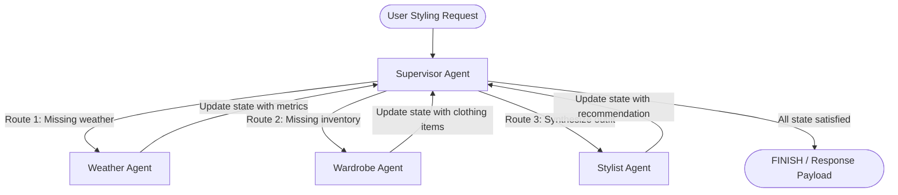
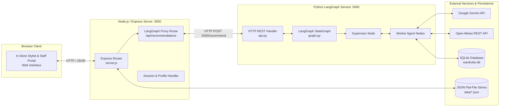

# Moda

> **Status: In Development**  
> An AI-powered styling assistant and shop-focused version of ThreadTheory that curates cohesive, weather-appropriate outfits strictly from a shop's real inventory.

Moda is the shop-focused version of ThreadTheory, designed as an AI styling assistant that recommends complete outfits strictly from a shop's real in-stock inventory. Rather than hallucinating non-existent garments, Moda grounds every suggestion in verified items from the store's database (`wardrobe.db`), taking into account live weather, occasions, and stock availability.

The core intelligence is powered by a **LangGraph multi-agent architecture** running on Python with **Google Gemini** and **Open-Meteo REST APIs**, bridged seamlessly to a responsive **Node.js/Express** editorial web application.

---

## ✨ Features

* **Multi-Agent Architecture**: LangGraph supervisor coordinates specialized worker agents (Weather, Wardrobe, Stylist) to deliver structured styling results with transparent execution traces.
* **In-Store Personal Shopper**: Interactive styling assistant generating up to 3 distinct outfit options (*One-Piece Dress*, *Classic Separates*, *Layered Statement*) based on occasions and categories.
* **Inventory-Grounded Recommendations**: Outfit recommendations are strictly constrained to verified items in the shop's SQLite database (`wardrobe.db`), displaying inventory limitation notices instead of hallucinating when stock cannot support a request.
* **Dynamic Bundle Pricing & Stock Transparency**: Calculates deterministic outfit bundle totals in rupees, displaying individual item prices, available sizes, and remaining stock counts.
* **Zero-Stock Exclusion**: Products with zero stock are automatically excluded from customer styling recommendations.
* **Staff Catalog Portal (`/staff`)**: Dedicated staff workspace for cataloging inventory with drag-and-drop garment photo upload, live inventory tables, and stock monitoring.
* **Gemini Vision Tagging with Needs Review Flags**: Auto-tags category, subcategory, color, pattern, formality, and season with confidence scores, automatically flagging attributes under 70% confidence for staff review.
* **Staff Override & Catalog Validation**: Staff edits always supersede AI suggestions, with strict server-side validation enforcing SKU uniqueness (`MODA-xxxx`), positive pricing, category-subcategory compatibility, and size availability.
* **Real-Time Weather Intelligence**: Live atmospheric conditions (temperature, precipitation chance, conditions) fetched automatically for the store location via the Open-Meteo REST API.

---

## 🤖 Multi-Agent AI Architecture

Moda coordinates reasoning across three specialized worker agents using a centralized **Supervisor Agent** built with **LangGraph**:



### Agent Responsibilities

| Agent | Responsibility | Tools & Data Sources |
| :--- | :--- | :--- |
| **Supervisor Agent** | Inspects the shared `AgentState` dictionary and dynamically determines the next transition step until reaching `FINISH`. | State conditional routing |
| **Weather Agent** | Extracts city location and retrieves real-time weather metrics (temperature, precipitation chance, conditions). | Open-Meteo REST API (`tools/weather.py`) |
| **Wardrobe Agent** | Queries and filters the shop's inventory matching formality, category, and temperature boundaries. | SQLite database query tool (`tools/wardrobe.py`) |
| **Stylist Agent** | Reasons over user intent, live weather constraints, and available items to compose a cohesive outfit and rationale. | Google Gemini LLM (`agents/stylist_agent.py`) |

---

## 🔄 How It Works

1. **Request Intake**: The user submits a styling prompt (e.g., *"casual coffee meeting, rainy weather"*) via the In-Store Stylist on the home page by choosing an occasion and category.
2. **Supervisor Assessment**: The Supervisor inspects `AgentState` and detects unpopulated weather data, routing execution to the **Weather Agent**.
3. **Weather Retrieval**: The Weather Agent queries the Open-Meteo REST API for live conditions in the target location (e.g., 26°C, 78% rain probability).
4. **Inventory Retrieval**: The Supervisor routes to the **Wardrobe Agent**, which queries `wardrobe.db` to retrieve in-stock items comfortable within the current temperature range and formality, filtering out zero-stock items.
5. **LLM Synthesis**: The Supervisor invokes the **Stylist Agent**. Google Gemini evaluates the in-stock inventory against the weather forecast and customer intent, composing up to three distinct outfit looks (*One-Piece Dress*, *Classic Separates*, *Layered Statement*) or returning an inventory limitation notice if stock cannot support the request.
6. **Parsing & DB Binding**: The Python backend cleans any Markdown artifacts from the LLM output, verifies item IDs against the database, and returns structured JSON to the Node.js layer.
7. **Frontend Presentation**: The Stylist screen renders up to three outfit looks with item prices, available sizes, remaining stock and the total bundle price.

---

## 🏗️ System Architecture



---

## 🛠️ Tech Stack

| Category | Technologies |
| :--- | :--- |
| **Frontend** | HTML5, Vanilla JavaScript, Tailwind CSS utility classes, Google Fonts (*Bodoni Moda*, *Cormorant Garamond*, *Jost*, *Caveat*) |
| **Web Server** | Node.js, Express.js, Multer, Body-Parser, CORS |
| **AI / Agent Framework** | Python 3.12, LangGraph, LangChain Core |
| **LLM Models** | Google Gemini (`gemini-2.5-flash` via `langchain-google-genai` and `@google/genai`) |
| **Databases & Storage** | SQLite (`wardrobe.db`), JSON storage (`data/users.json`, `data/wardrobe.json`, `data/planner.json`, etc.) |
| **External APIs** | Open-Meteo REST API (Live weather metrics) |
| **Testing** | Pytest, Python `unittest` |
| **Build & Tooling** | Vite (frontend development), Python virtual environments (`venv`) |

---

## 📁 Project Structure

```text
Moda/
├── docs/                       # Staff user guide and rollout documentation
├── agents/                     # LangGraph Agent implementations
│   ├── stylist_agent.py        # Gemini reasoning agent for outfit synthesis
│   ├── wardrobe_agent.py       # Inventory filtering agent
│   └── weather_agent.py        # Open-Meteo weather agent
├── services/                   # Staff cataloging and inventory services
│   └── staff_catalog.py        # Commercial validation, AI tagging review, and DB sync
├── tools/                      # Tool definitions invoked by agents
│   ├── item_tagger.py          # Gemini Vision automated clothing photo-tagging tool
│   ├── wardrobe.py             # SQLite parameterized query interface
│   └── weather.py              # Open-Meteo geocoding and forecast fetcher
├── tests/                      # Automated test suite
│   ├── test_api.py             # API endpoint and Markdown parsing tests
│   ├── test_graph.py           # LangGraph orchestration state machine tests
│   ├── test_stylist_agent.py   # Stylist agent unit tests
│   ├── test_wardrobe_agent.py  # Wardrobe agent unit tests
│   ├── test_wardrobe_tool.py   # Database query tool tests
│   ├── test_weather_agent.py   # Weather agent unit tests
│   └── test_weather_tool.py    # Open-Meteo REST integration tests
├── data/                       # Local JSON stores for shop inventory (inventory.json, wardrobe.json) and app data
├── public/                     # Static assets and uploads
├── api.py                      # Python HTTP REST API server (Port 5000)
├── graph.py                    # LangGraph StateGraph & Supervisor logic
├── server.js                   # Node.js/Express web server (Port 3000)
├── setup_db.py                 # SQLite wardrobe database initialisation script
├── staff.html                  # Staff cataloging and product review portal
├── test_env.py                 # Environment and dependency verification script
├── requirements.txt            # Python dependencies
├── package.json                # Node.js dependencies and scripts
└── .env.example                # Sample environment variables template
```

---

## 📚 Documentation

- [User Guide](docs/user-guide.md) — Quick-start job aids and FAQ for shop staff.
- [Rollout Plan](docs/rollout-plan.md) — Change management and communications plan for retail shop pilots.

Both documents are drafts and have not yet been tested with real users.

---

## 🚀 Getting Started

### Prerequisites

* **Python**: 3.10 to 3.12
* **Node.js**: v18 or later
* **Google Gemini API Key**: Obtainable free from [Google AI Studio](https://aistudio.google.com/)

### 1. Clone the Repository

```bash
git clone https://github.com/Aashi0105/Moda.git
cd Moda
```

### 2. Python Environment Setup

Create and activate a virtual environment, then install Python dependencies:

**Windows (PowerShell):**
```powershell
python -m venv venv
.\venv\Scripts\Activate.ps1
pip install -r requirements.txt
```

**macOS / Linux:**
```bash
python3 -m venv venv
source venv/bin/activate
pip install -r requirements.txt
```

### 3. Node.js Setup

Install frontend and server dependencies:

```bash
npm install
```

### 4. Database Setup

Initialize the local SQLite database. This creates `wardrobe.db` seeded with demo shop inventory items:

```bash
python setup_db.py
```

> **Note**: `wardrobe.db` is intentionally excluded from Git. Running `python setup_db.py` deterministically generates the database locally.

### 5. Environment Variables

Copy the example environment template and add your API credentials:

```bash
cp .env.example .env
```

Open `.env` and set your Google Gemini API key:
```env
GEMINI_API_KEY=your_gemini_api_key_here
GOOGLE_API_KEY=your_gemini_api_key_here
```

### 6. Verify Environment

Run the automated diagnostic check to ensure all dependencies and credentials are functioning:

```bash
python test_env.py
```

### 7. Running the Application

Start both the Python LangGraph backend and the Node.js web server:

**Terminal 1 — Python LangGraph REST API:**
```bash
python api.py
```
*API runs at `http://localhost:5000/recommend`*

**Terminal 2 — Node.js / Express Web Server:**
```bash
node server.js
```
*Web application runs at `http://localhost:3000`*

Open `http://localhost:3000` in your browser.

---

## 🧪 Testing

The repository contains an automated test suite covering tools, agents, graph routing, and API handlers.

Run the test suite with `pytest`:

```bash
python -m pytest tests/
```

### Verified Test Suite Result

```text
tests/test_api.py ..                                                     [  2%]
tests/test_app.py .                                                      [  3%]
tests/test_customer_experience.py ..........                             [ 14%]
tests/test_graph.py .                                                    [ 16%]
tests/test_item_tagger.py .................                              [ 35%]
tests/test_personal_shopper.py ......................                    [ 60%]
tests/test_shop_inventory.py .............                               [ 75%]
tests/test_staff_review.py ..........                                    [ 87%]
tests/test_stylist_agent.py .                                            [ 88%]
tests/test_wardrobe_agent.py ....                                        [ 93%]
tests/test_wardrobe_tool.py ...                                          [ 96%]
tests/test_weather_agent.py .                                            [ 97%]
tests/test_weather_tool.py ..                                            [100%]

============================= 87 passed in 29.75s =============================
```

### Test Coverage Highlights

* **Shop Inventory & Grounding**: SKU validation, zero-stock exclusion, product suitability guards, and anti-hallucination constraints (`test_shop_inventory.py`).
* **Staff Cataloging & Review**: Gemini Vision auto-tagging, confidence scores, Needs Review flags, staff edit overrides, and commercial validation (`test_staff_review.py`, `test_item_tagger.py`).
* **In-Store Personal Shopper**: 3-look formulas (dress, separates, layered), bundle pricing calculation, weather integration, and customer UI isolation (`test_personal_shopper.py`, `test_customer_experience.py`).
* **Multi-Agent State Machine**: LangGraph supervisor routing (`Weather → Wardrobe → Stylist → FINISH`) (`test_graph.py`, `test_stylist_agent.py`, `test_wardrobe_agent.py`).
* **API & Integration**: HTTP REST endpoints, Markdown sanitization, and DB foreign key binding (`test_api.py`, `test_app.py`).

---

## 🔐 Security & Privacy

* **Secrets Management**: `.env` is excluded via `.gitignore`. API keys and credentials are never checked into version control.
* **Clean Template**: `.env.example` contains only descriptive placeholders without real credentials.
* **Runtime Uploads Ignored**: `public/uploads/*` is excluded (with `.gitkeep` maintained) to prevent personal garment photos or avatars from being tracked.
* **Sanitized Demo Data**: Flat-file JSON databases (`data/*.json`) use generic demo accounts (`demo@threadtheory.io`) with salted PBKDF2 password hashes.
* **Local Databases**: SQLite database files (`*.db`, `*.sqlite3`) are ignored to avoid committing mutated local runtime state.

---

## 🧠 Technical Highlights

* **Supervisor Routing Pattern**: Uses a dedicated supervisor node that evaluates state gaps dynamically rather than relying on a brittle static prompt chain.
* **Separation of Concerns**: Decouples weather fetching (REST tool), wardrobe querying (SQL tool), and styling logic (LLM) into isolated, independently testable units.
* **Resilient Markdown Parsing**: Cleans formatting variations from LLM outputs using regular expressions before querying the database, preventing `null` foreign key bindings.
* **Dual-Tier Query Fallback**: Incorporates deterministic fast-path query routing for standard requests to minimize latency and conserve LLM API quotas.
* **Defensive Error Handling**: Express backend includes timeout controllers and fallback handlers so network interruptions or API limits never crash the client UI.

---

## 📊 Example Recommendation

### Request Payload

```json
POST /recommend HTTP/1.1
Host: localhost:5000
Content-Type: application/json

{
  "prompt": "casual coffee meeting, rainy weather",
  "city": "Vadodara"
}
```

### Structured Response

```json
{
  "success": true,
  "top": {
    "id": 7,
    "name": "Graphic Vintage Tee"
  },
  "bottom": {
    "id": 9,
    "name": "Dark Wash Slim Jeans"
  },
  "outerwear": {
    "id": 3,
    "name": "Beige Lightweight Windbreaker"
  },
  "shoes": {
    "id": 14,
    "name": "Minimalist White Leather Sneakers"
  },
  "weather": {
    "city": "Vadodara",
    "temperature": 26.6,
    "condition": "Partly Cloudy",
    "rain_probability": 78,
    "wind_speed": 6.5
  },
  "recommended_outfit": {
    "top": { "id": 7, "name": "Graphic Vintage Tee" },
    "bottom": { "id": 9, "name": "Dark Wash Slim Jeans" },
    "outerwear": { "id": 3, "name": "Beige Lightweight Windbreaker" },
    "shoes": { "id": 14, "name": "Minimalist White Leather Sneakers" },
    "accessories": "UV Protection Sunglasses"
  },
  "full_recommendation": "### 👔 Recommended Outfit\n- **Top:** Graphic Vintage Tee\n- **Bottom:** Dark Wash Slim Jeans\n- **Outerwear:** Beige Lightweight Windbreaker\n- **Shoes:** Minimalist White Leather Sneakers\n- **Accessories:** UV Protection Sunglasses\n\n### 💡 Stylist Rationale\nThis outfit balances your styling request for casual coffee meeting, rainy weather in Vadodara with real-time weather in Vadodara (26.6°C, Partly Cloudy, 78% rain probability). The selected layers ensure comfort and color harmony.",
  "execution_trace": [
    "Supervisor ➔ Weather Agent",
    "Weather Agent Executed",
    "Supervisor ➔ Wardrobe Agent",
    "Wardrobe Agent Executed",
    "Supervisor ➔ Stylist Agent",
    "Stylist Agent Executed",
    "Supervisor ➔ FINISH"
  ],
  "retrieved_wardrobe_count": 6
}
```

---

## 🧩 Challenges & Engineering Decisions

* **Overcoming LLM Hallucinations**: Prompting an LLM to recommend clothing often leads to fictional garments. We addressed this by implementing parameterized SQL retrieval where only verified garment IDs are provided to the model, so recommendations only include items from the shop's verified inventory.
* **Decoupled Architecture**: Rather than maintaining a monolithic Python app, we divided responsibilities between an Express server (specialized in static asset serving, session handling, and file uploads) and a Python microservice (specialized in LangGraph state machines and LLM integrations).
* **LLM Markdown Sanitization**: Gemini occasionally returned item names wrapped in bold asterisks (e.g. `**Beige Lightweight Windbreaker**`). A sanitization layer was built into `api.py` to strip Markdown artifacts before database lookup, ensuring foreign keys resolve accurately.
* **Graceful Degradation**: To prevent UI freezes if external APIs experience latency or rate limits, the system features configurable timeouts and rule-based fallback engines.

---

## 🔮 Future Improvements

* [ ] **Multi-Shop Inventory DBs**: Migrate SQLite to PostgreSQL for multi-tenant shop inventory isolation in production deployments.
* [ ] **Vector Similarity Search**: Add semantic embeddings (e.g., ChromaDB) for aesthetic style matching beyond categorical queries.
* [ ] **Point-of-Sale (POS) Integration**: Synchronize inventory stock counts directly with in-store barcode scanners and registers.

---

## 👩‍💻 Author

**Aashi Vora**  
* GitHub: [https://github.com/Aashi0105](https://github.com/Aashi0105)
